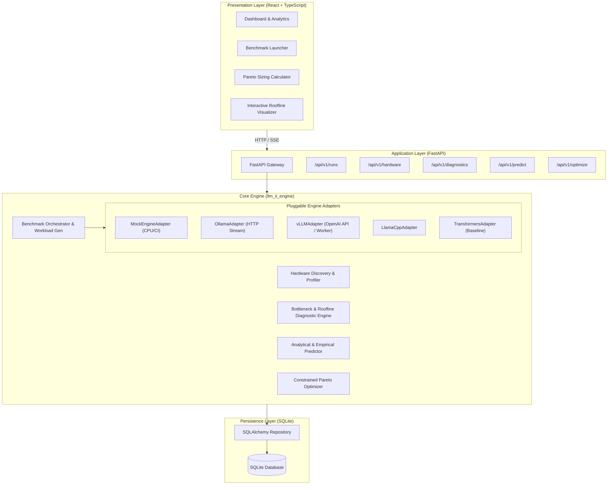
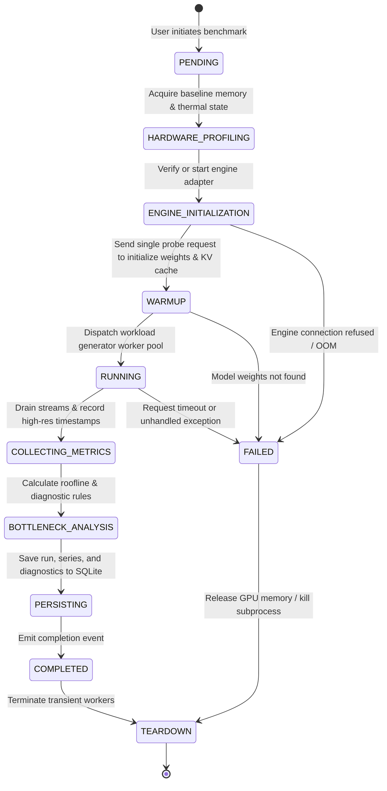
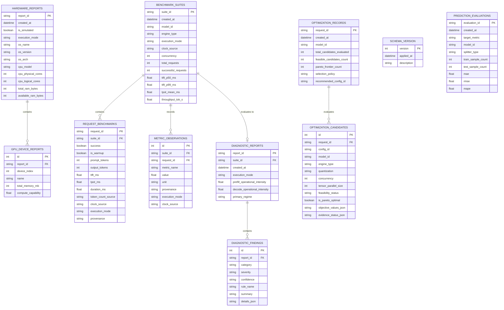

# LLM Inference Intelligence Engine — System Architecture & Contracts

## 1. High-Level Architectural Overview

The **LLM Inference Intelligence Engine (IIE)** is structured as a modular, decoupled application composed of four primary layers:
1. **Interactive Frontend Layer** (`frontend/`): Single-page application built with React, TypeScript, and Tailwind CSS.
2. **Application & API Layer** (`backend/`): Lightweight FastAPI web service exposing REST endpoints and SSE/WebSocket streaming for real-time benchmark telemetry.
3. **Core Intelligence & Execution Engine** (`llm_ii_engine/`): Pure Python domain package containing hardware discovery, benchmark runners, engine adapters, roofline diagnostics, performance predictors, and configuration optimizers.
4. **Persistence Layer** (`storage/`): SQLite database with SQLAlchemy/SQLModel ORM for reproducible experiment cataloging and metadata persistence.



---

## 2. Target Workspace & Directory Layout

To maintain high maintainability for a solo developer while ensuring modularity and clean separation of concerns, the repository is organized as follows:

```text
LLM-Inference-Intelligence-Engine/
├── .gitignore
├── README.md
├── pyproject.toml              # Unified Python project configuration (uv / pip)
├── docs/
│   ├── requirements.md         # Product specification & acceptance criteria
│   ├── architecture.md         # Architecture, contracts, and schemas
│   └── implementation-plan.md  # Step-by-step roadmap & session milestones
├── llm_ii_engine/              # Core Python Intelligence Package
│   ├── __init__.py
│   ├── core/                   # Shared enums, types, config, constants
│   │   ├── enums.py            # ProvenanceType, EngineType, Quantization, MetricType
│   │   ├── exceptions.py       # Domain-specific error hierarchies
│   │   └── schemas.py          # Core Pydantic data schemas & contracts
│   ├── discovery/              # Hardware discovery and roofline capacity
│   │   ├── profiler.py         # CPU, RAM, GPU topology detection
│   │   └── hardware_db.py      # Known hardware memory bandwidth & peak TFLOPs
│   ├── adapters/               # Pluggable engine adapters
│   │   ├── base.py             # BaseInferenceAdapter protocol & abstract class
│   │   ├── mock.py             # MockEngineAdapter for deterministic CPU/CI testing
│   │   ├── ollama.py           # Ollama REST / streaming client adapter
│   │   ├── vllm.py             # vLLM server adapter
│   │   └── llamacpp.py         # llama.cpp server adapter
│   ├── benchmark/              # Benchmark execution orchestrator
│   │   ├── runner.py           # Isolated benchmark executor & concurrency worker pool
│   │   ├── workload.py         # Synthetic & distribution-based prompt generators
│   │   ├── collector.py        # High-resolution timing & token telemetry collector
│   │   └── memory.py           # Host RAM & VRAM background sampler
│   ├── diagnostics/            # Bottleneck root-cause & roofline diagnostics
│   │   ├── roofline.py         # Operational intensity & roofline curve analysis
│   │   ├── kv_cache.py         # KV cache memory headroom & thrashing detector
│   │   └── rules.py            # Evidence-based diagnostic rule catalog
│   ├── prediction/             # Performance modeling
│   │   ├── analytical.py       # First-principles transformer scaling formulas
│   │   ├── empirical.py        # ML / Regression estimators for TTFT & throughput
│   │   └── evaluation.py       # Train/test split, MAE, MAPE, RMSE evaluation
│   ├── optimizer/              # Configuration recommendation
│   │   ├── pareto.py           # Multi-objective non-dominated frontier solver
│   │   └── recommender.py      # SLA-constrained configuration recommender
│   └── storage/                # Persistence & Data Access
│       ├── database.py         # Engine & session management (SQLite)
│       ├── models.py           # SQLAlchemy / SQLModel ORM entities
│       └── repository.py       # Repository query methods
├── backend/                    # FastAPI Web Service
│   ├── __init__.py
│   ├── main.py                 # FastAPI application factory & lifespan
│   ├── dependencies.py         # Dependency injection (DB session, engine instances)
│   └── routers/
│       ├── hardware.py         # Hardware discovery endpoints
│       ├── benchmarks.py       # Benchmark execution & run history endpoints
│       ├── diagnostics.py      # Diagnostic evaluation endpoints
│       ├── predictions.py      # Performance prediction & model evaluation
│       └── recommendations.py  # Constrained optimization endpoints
├── frontend/                   # React + TypeScript Web Application
│   ├── package.json
│   ├── tsconfig.json
│   ├── vite.config.ts
│   ├── src/
│   │   ├── api/                # Typed REST client & SSE hooks
│   │   ├── components/         # Shared UI components (cards, tables, badges)
│   │   ├── features/           # Feature modules
│   │   │   ├── discovery/      # Hardware profile overview
│   │   │   ├── benchmark/      # Benchmark launcher & live metrics stream
│   │   │   ├── comparison/     # Multi-run comparison matrix & distributions
│   │   │   ├── diagnostics/    # Roofline charts & bottleneck breakdown
│   │   │   └── optimizer/      # Sizing & recommendation query builder
│   │   ├── types/              # TypeScript interfaces mirror backend Pydantic models
│   │   ├── App.tsx
│   │   └── main.tsx
└── tests/                      # Automated Test Suite
    ├── conftest.py             # Pytest fixtures (mock hardware, mock adapters, test DB)
    ├── unit/
    │   ├── test_discovery.py
    │   ├── test_mock_adapter.py
    │   ├── test_metrics_collector.py
    │   ├── test_roofline_diagnostics.py
    │   ├── test_prediction_models.py
    │   └── test_pareto_optimizer.py
    ├── integration/
    │   ├── test_benchmark_runner.py
    │   ├── test_sqlite_persistence.py
    │   └── test_api_endpoints.py
    └── fixtures/               # Seeded payloads, mocked engine responses
```

---

## 3. Main Domain Entities & Data Contracts

All data entities enforce strict schema validation via Pydantic v2 in Python and corresponding TypeScript interfaces in the frontend.

### 3.1 Data Provenance Principle
Every metric or observation is explicitly categorized using the `ProvenanceType` enum:
```python
from enum import Enum


class ProvenanceType(str, Enum):
    MEASURED = "MEASURED"  # Directly observed from a real/simulated benchmark execution
    PREDICTED = "PREDICTED"  # Estimated by the analytical/empirical prediction model
    HEURISTIC = "HEURISTIC"  # Derived from hardware catalog specs or theoretical formulas
```

### 3.2 Core Pydantic Schemas

```python
from datetime import datetime
from typing import List, Optional, Dict, Any
from pydantic import BaseModel, Field


class HardwareProfile(BaseModel):
    id: str
    hostname: str
    os_name: str
    cpu_model: str
    cpu_physical_cores: int
    cpu_logical_cores: int
    total_ram_bytes: int
    gpu_count: int
    gpus: List[Dict[str, Any]] = Field(default_factory=list)
    theoretical_memory_bandwidth_gbps: float
    theoretical_peak_tflops_fp16: float
    is_simulated: bool = False
    created_at: datetime = Field(default_factory=datetime.utcnow)


class ModelSpec(BaseModel):
    model_id: str  # e.g., "meta-llama/Meta-Llama-3-8B-Instruct"
    family: str  # "llama", "mistral", "qwen", etc.
    parameter_count_billion: float  # e.g., 8.0
    context_window_limit: int  # e.g., 8192
    num_layers: int  # e.g., 32
    num_attention_heads: int  # e.g., 32
    num_kv_heads: int  # e.g., 8 (GQA)
    hidden_dimension: int  # e.g., 4096
    vocab_size: int  # e.g., 128256


class EngineConfig(BaseModel):
    engine_type: str  # "mock", "ollama", "vllm", "llamacpp"
    quantization: str  # "fp16", "int8", "int4", "q4_k_m", etc.
    tensor_parallel_size: int = 1
    max_model_len: int = 4096
    gpu_memory_utilization: float = 0.9
    extra_args: Dict[str, Any] = Field(default_factory=dict)


class WorkloadProfile(BaseModel):
    concurrency: int = 1  # Number of concurrent client streams
    total_requests: int = 10  # Total requests to send in the benchmark
    prompt_tokens_mean: int = 512  # Average prompt tokens
    prompt_tokens_std: int = 0
    output_tokens_mean: int = 128  # Average generation tokens
    output_tokens_std: int = 0
    temperature: float = 0.0  # Deterministic decoding for timing fidelity


class TokenTiming(BaseModel):
    token_index: int
    timestamp_ns: int
    delta_ns: int  # Inter-token latency in nanoseconds


class RequestMeasurement(BaseModel):
    request_id: str
    prompt_tokens: int
    output_tokens: int
    ttft_ms: float  # Time-to-First-Token
    tpot_ms: float  # Time-Per-Output-Token (average decode token latency)
    total_latency_ms: float  # Total request duration
    inter_token_latencies_ms: List[float] = Field(default_factory=list)
    success: bool = True
    error_message: Optional[str] = None


class BenchmarkAggregateMetrics(BaseModel):
    total_requests: int
    successful_requests: int
    failed_requests: int
    total_prompt_tokens: int
    total_output_tokens: int
    elapsed_time_sec: float

    # Latency Distributions (ms)
    ttft_p50_ms: float
    ttft_p90_ms: float
    ttft_p95_ms: float
    ttft_p99_ms: float

    tpot_mean_ms: float
    itl_p50_ms: float
    itl_p90_ms: float
    itl_p95_ms: float
    itl_p99_ms: float

    # Throughput
    tokens_per_second: float  # Total tokens / elapsed time
    output_tokens_per_second: float  # Output tokens / elapsed time
    requests_per_second: float  # Requests / elapsed time

    # Memory Watermark (MB)
    baseline_memory_mb: float
    peak_memory_mb: float
    kv_cache_allocated_mb: Optional[float] = None

    provenance: ProvenanceType = ProvenanceType.MEASURED


class BenchmarkRun(BaseModel):
    id: str
    status: str  # "PENDING", "RUNNING", "COMPLETED", "FAILED"
    hardware_id: str
    model_spec: ModelSpec
    engine_config: EngineConfig
    workload_profile: WorkloadProfile
    metrics: Optional[BenchmarkAggregateMetrics] = None
    raw_measurements: List[RequestMeasurement] = Field(default_factory=list)
    created_at: datetime = Field(default_factory=datetime.utcnow)
    completed_at: Optional[datetime] = None


class DiagnosticFinding(BaseModel):
    rule_id: str
    title: str
    severity: str  # "INFO", "WARNING", "CRITICAL"
    regime: str  # "MEMORY_BOUND", "COMPUTE_BOUND", "LATENCY_BOUND"
    operational_intensity_flops_per_byte: float
    machine_balance_flops_per_byte: float
    summary: str
    evidence: Dict[str, Any]
    recommendation: str


class RecommendationConstraint(BaseModel):
    max_ttft_ms: Optional[float] = None
    max_tpot_ms: Optional[float] = None
    min_tokens_per_sec: Optional[float] = None
    max_memory_mb: Optional[float] = None
    max_concurrency: int = 16
    allowed_quantizations: List[str] = Field(default_factory=list)


class RecommendedRecipe(BaseModel):
    rank: int
    engine_type: str
    quantization: str
    concurrency: int
    estimated_ttft_ms: float
    estimated_tpot_ms: float
    estimated_throughput_tok_s: float
    estimated_peak_memory_mb: float
    is_pareto_optimal: bool
    provenance: ProvenanceType
    rationale: str
```

---

## 4. Experiment Lifecycle State Machine

Each benchmark execution progresses through a deterministic lifecycle, guaranteeing proper isolation, resource monitoring, and clean teardown.



---

## 5. Subsystem Interfaces & Contracts

### 5.1 Inference Engine Adapter Protocol
All engines implement a unified asynchronous protocol, enabling pluggable engine swapping without modifying the benchmark runner.

```python
from typing import Protocol, AsyncIterator, runtime_checkable


class TokenEvent(BaseModel):
    token: str
    timestamp_ns: int
    is_first_token: bool = False
    is_last_token: bool = False


@runtime_checkable
class InferenceEngineAdapter(Protocol):
    """Protocol defining the standard interface for LLM inference engines."""

    async def initialize(self, model_spec: ModelSpec, config: EngineConfig) -> bool:
        """Initialize engine, prepare endpoints, or load weights."""
        ...

    async def health_check(self) -> bool:
        """Verify the engine is reachable and ready to accept inference requests."""
        ...

    async def generate_stream(
        self, prompt: str, max_tokens: int, temperature: float = 0.0
    ) -> AsyncIterator[TokenEvent]:
        """Stream generated tokens, attaching monotonic nanosecond timestamps."""
        ...

    async def get_memory_usage_mb(self) -> float:
        """Return current memory consumption (VRAM if GPU, RSS if CPU)."""
        ...

    async def teardown(self) -> None:
        """Clean up process handles, clear KV cache, or shutdown server."""
        ...
```

### 5.2 Roofline Diagnostic Engine Interface
```python
class DiagnosticEngine:
    def evaluate(
        self, hardware: HardwareProfile, model: ModelSpec, run: BenchmarkRun
    ) -> List[DiagnosticFinding]:
        """
        Calculates operational intensity for prefill and decode phases,
        maps against the hardware roofline ceiling, evaluates memory saturation,
        and outputs evidence-backed bottleneck diagnostics.
        """
        ...
```

### 5.3 Performance Predictor Interface
```python
class PerformancePredictor:
    def fit(self, historical_runs: List[BenchmarkRun]) -> Dict[str, float]:
        """
        Fits empirical regression models on historical benchmark measurements.
        Returns training loss and evaluation metrics.
        """
        ...

    def evaluate_held_out(self, test_runs: List[BenchmarkRun]) -> Dict[str, float]:
        """
        Computes MAE, MAPE, and RMSE across held-out runs.
        """
        ...

    def predict(
        self,
        hardware: HardwareProfile,
        model: ModelSpec,
        config: EngineConfig,
        workload: WorkloadProfile,
    ) -> BenchmarkAggregateMetrics:
        """
        Predicts TTFT, TPOT, throughput, and memory with provenance: PREDICTED.
        """
        ...
### 5.4 Constrained Configuration Optimizer & Pareto Search Interface
```python
class ConfigurationOptimizer:
    """Orchestrates candidate generation, evaluation, constraint checking, and Pareto optimization."""

    def __init__(
        self,
        predictors: dict[PredictionTarget, BasePredictor] | None = None,
        empirical_observations: list[PredictionRecord] | None = None,
    ) -> None:
        ...

    def optimize(self, request: OptimizationRequest) -> OptimizationResult:
        """
        Enforces hard feasibility constraints (context window, engine-quantization compatibility,
        VRAM limits with safety margins, and latency/throughput SLAs).
        Evaluates objective values using measured observations, empirical ML predictions, or
        theoretical Roofline ceilings, with explicit provenance tagging.
        Filters out dominated candidates and extracts the non-dominated Pareto frontier.
        """
        ...
```

---

## 6. Persistence & SQLite Relational Schema

### SQLite Engine Pragmas & Storage Guarantees

The persistence layer is implemented with **SQLAlchemy 2.x** targeting SQLite with explicit enterprise concurrency and reliability settings:
1. **Foreign Key Enforcement**: `PRAGMA foreign_keys = ON;` is executed on every database connection check-in.
2. **Write-Ahead Logging (WAL)**: `PRAGMA journal_mode = WAL;` enables concurrent read transactions while background benchmarks record observations.
3. **Busy Timeout**: `PRAGMA busy_timeout = 5000;` prevents `database is locked` race conditions between concurrent readers and background runners.
4. **Schema Versioning**: `schema_version` table tracks applied migrations and raises fatal initialization errors if code encounters a newer unhandled database version.



---

## 7. REST API Endpoints Specification

The REST API layer is built on FastAPI (`llm_ii_engine.api`) providing typed schemas, uniform error models (`APIErrorResponse`), background execution, and Server-Sent Events (SSE) telemetry.

| Method | Endpoint | Description |
|---|---|---|
| `GET` | `/health` | Service and database readiness/liveness probe |
| `GET` | `/api/v1/hardware` | Discover and return current host CPU, RAM, and GPU topology |
| `GET` | `/api/v1/hardware/reports` | List historical hardware discovery reports |
| `GET` | `/api/v1/hardware/{report_id}` | Retrieve a persisted hardware discovery report by ID |
| `POST` | `/api/v1/benchmarks/run` | Submit an asynchronous benchmark job (returns HTTP 202 with `job_id`) |
| `GET` | `/api/v1/benchmarks/jobs` | List active, pending, completed, or cancelled in-memory benchmark jobs |
| `GET` | `/api/v1/benchmarks/jobs/{job_id}` | Inspect current job status, execution lifecycle, and results |
| `POST` | `/api/v1/benchmarks/jobs/{job_id}/cancel` | Cancel an active or pending background benchmark execution job |
| `GET` | `/api/v1/benchmarks/jobs/{job_id}/stream` | Server-Sent Events (SSE) real-time streaming of `TokenStreamEvent`s |
| `GET` | `/api/v1/benchmarks` | Query historical benchmark suites with filtering and pagination |
| `GET` | `/api/v1/benchmarks/{suite_id}` | Retrieve detailed benchmark suite result, requests, and observations |
| `POST` | `/api/v1/diagnostics/run` | Run analytical Roofline and bottleneck diagnostics on a benchmark suite |
| `GET` | `/api/v1/diagnostics` | List historical diagnostic reports |
| `GET` | `/api/v1/diagnostics/{report_id}` | Retrieve diagnostic report and typed findings by ID |
| `POST` | `/api/v1/predictions/evaluations` | Persist an empirical or baseline prediction evaluation record |
| `GET` | `/api/v1/predictions/evaluations` | List historical empirical prediction evaluation results |
| `GET` | `/api/v1/predictions/evaluations/{id}` | Retrieve a prediction evaluation result by ID |
| `POST` | `/api/v1/optimize/recommend` | Run constrained Pareto optimization across engine configurations |
| `GET` | `/api/v1/optimize/history` | List historical optimization requests and recommendations |
| `GET` | `/api/v1/optimize/{request_id}` | Retrieve optimization request, Pareto frontier, and candidate evaluations |

---

## 8. Development & Architectural Guarantees

1. **CPU & Mock First**: The `MockEngineAdapter` simulates deterministic prefill and decode delays with configurable statistical jitter, ensuring all integration tests, CI pipelines, and developer UI workflows function on CPU-only machines without GPU drivers.
2. **Subprocess Isolation**: When interfacing with real local runtimes (such as Ollama or llama.cpp), processes are monitored with explicit timeouts, automatic SIGTERM/SIGKILL handlers, and VRAM reclamation.
3. **Reproducibility**: Benchmark runs capture complete environment metadata (OS version, CPU architecture, driver version, engine version, temperature, random seed).
4. **Zero Overhead Timing**: Latency instrumentation uses Python's monotonic clock (`time.perf_counter_ns()`) to prevent clock skew or NTP synchronization anomalies.
